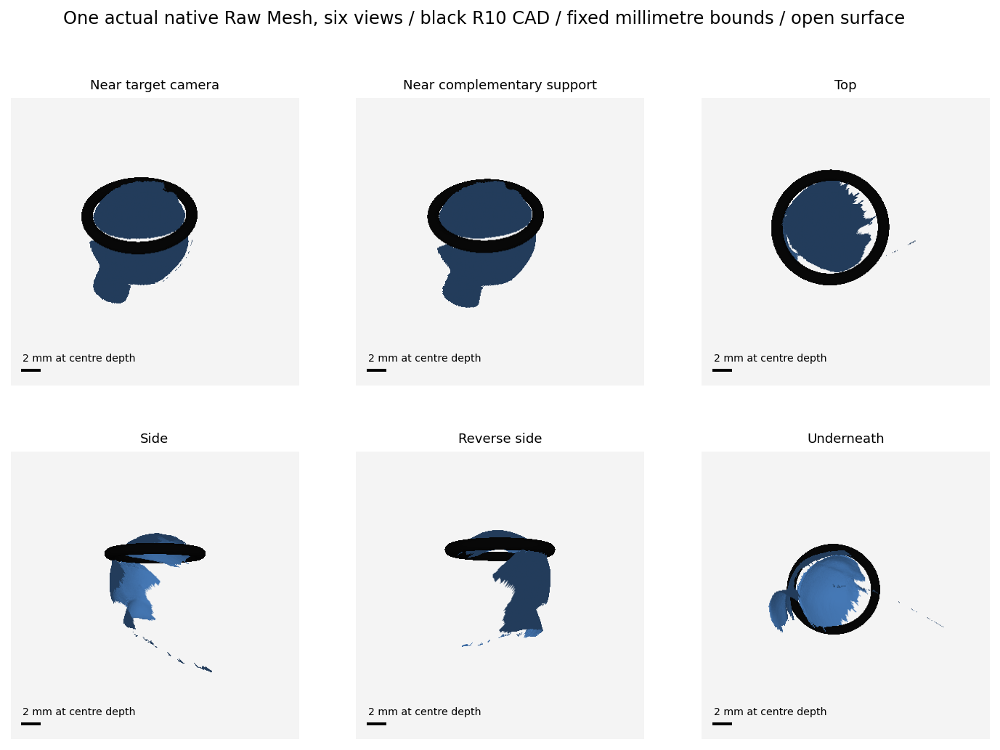

# Ring-First + HERO Core

A small research handoff of the existing **Ring-First metric camera + MVSAnywhere HERO** visible-surface pipeline. Repository visibility is **Private**. This release reproduces a real G01 case; it introduces no new reconstruction method.

```text
RGB + Background/Polyp/Ring labels
  → Ring-First 5DoF + real reference-map RGB disambiguation
  → fixed conditional c2w cameras
  → official HERO (one target + three support images)
  → native axial depth → metric XYZ → original Raw open Mesh
  → optional original017 classifications → visualization
```

The reference RGB map is an explicit input to full pose disambiguation. Ring-only geometry cannot determine all six camera degrees of freedom. Some frozen support cameras also include the historical Ceres refinement described below.



## What is included

- Portable Python modules and CLI for the original Ring solve, real SIFT-map PnP/yaw selection, official HERO loading/inference, half-pixel geometry, native-grid meshing, optional cleaning and actual-Mesh rendering.
- One controlled G01/video004 example: `G01_v004_raw00341`, with three original support frames. Its file/hash index is in [examples/G01_demo](examples/G01_demo/DATA_MANIFEST.json); the input data itself is distributed separately.
- Real derived GLB geometry, twelve curated core/historical images, and an offline browser gallery with independent source switches.
- CPU contracts, real-example integration tests and execution receipts in [validation](validation/).

No original video, personal data, model weights, complete third-party source checkout, Body, DXY diameter algorithm, TSDF/SDF or surface fusion is included.

## Version identity

The project snapshot is [`ring-first-3d@5636aaeb…`](https://github.com/zheng1524/ring-first-3d/tree/5636aaebd61a3d53b69f528692c4c7095df46508).

| Frozen project source | SHA256 |
| --- | --- |
| `cameras.py` | `ba95a389fc6722841491c3f876906e0014262c8baa055637a648bc66378db95f` |
| `torus.py` | `904d9cae48c1cc9317454c2feb80a331908009e095683851c8e8e3c80625191d` |
| `infer.py` | `c48926cb8ede2792a903436c6478f4fd44f00a8e261c9408521165db738c7049` |

**A historical provenance error was corrected:** `4483e25…` is a commit of the parent local research repository, not an official MVSAnywhere commit. The actual 105 used Python/config files are byte-identical to official [MVSAnywhere `5bd49bba…`](https://github.com/nianticlabs/mvsanywhere/commit/5bd49bba0992aa56060e1aa3bb40b2150b04726f). No network or weights were replaced. The full expected/actual audit, DINOv2 pin, checkpoint SHA and camera scope are in [VERSION_LOCK.json](VERSION_LOCK.json).

## Environment

Tested: Python 3.12.13, PyTorch 2.7.1+cu128, OpenCV 4.11.0, Open3D 0.19.0 and an RTX3060 Laptop GPU. The actual fresh inference allocated about 1.51 GB peak CUDA memory, excluding other processes and cached reservation. See [ENVIRONMENT.md](ENVIRONMENT.md) for the exact tested package set, read-only local dependency reuse and a new-host installation recipe.

Activate your prepared environment, then install this checkout:

```bash
python -m pip install --no-deps --no-build-isolation -e .
python -m ring_first_hero --help
```

These commands and the minimal commands below were executed in the new project environment. A completely fresh CUDA environment download/build was not performed on this disk-constrained workstation.

## Get the controlled example and official dependencies

Follow [DATA_ACCESS.md](DATA_ACCESS.md) to obtain the real example bundle through the maintainer. It is not a public download and is not included in Git. After authorized extraction, the example lives at `.local_data/G01_demo/`.

Obtain official MVSAnywhere and DINOv2 at the pins in `VERSION_LOCK.json`. Obtain the HERO checkpoint from its [official download URL](https://storage.googleapis.com/niantic-lon-static/research/mvsanywhere/mvsanywhere_hero.ckpt), subject to the [upstream licence](LICENSES/MVSAnywhere.txt). The file must have SHA256:

```text
00878bab903b1d384cd6bb9ea092e247a9036d429cb8bcc3d6dcbb81f67e556d
```

Create a **local-only** `site_config.local.json` using [the template](examples/runtime_config.example.json). Its three paths point to external official dependencies and the checkpoint, not to old experiment scripts. The CLI verifies all 105 MVSAnywhere and 156 DINOv2 source files before loading the 535 learned tensors; it never downloads replacement weights.

## Minimal execution

Run from the repository root:

```bash
# Actually recover the target camera from real RGB/Mask and the supplied SIFT reference map.
python -m ring_first_hero camera_demo \
  --data .local_data/G01_demo --out outputs/camera

# Actual new official inference with all four frozen cameras, optional cleaning and figures.
python -m ring_first_hero hero_demo \
  --data .local_data/G01_demo \
  --runtime-config site_config.local.json \
  --out outputs/hero --clean --compare-history --visualize

# Re-render saved native geometry without running inference.
python -m ring_first_hero visualize \
  --data .local_data/G01_demo --output outputs/hero --gallery visualization

python -m pytest -q

# Serve only the gallery, not the private input directory.
python -m http.server 8765 --bind 127.0.0.1 --directory visualization
```

Open `http://127.0.0.1:8765/`. The pinned, MIT-licensed viewer runtime is included, so the gallery does not require an external CDN. Raw, Trusted, Ring and real camera objects can be inspected separately. G03 contains two independent frozen same-video sources, not a newly fused surface.

`camera_demo --ring-only` is an optional diagnostic: it explicitly returns `RING_ONLY_YAW_UNRESOLVED`. It does not certify a complete camera trajectory.

## Inputs and outputs

Input labels are integer `0=Background`, `1=Polyp`, `2=Ring`. Work images are RGB 640×360. `K` uses integer index-centred pixel coordinates; `c2w_mm` maps OpenCV camera coordinates into the fixed Ring world, with translations in millimetres. R10 means **10 mm inner diameter**, with torus major radius 5.6 mm and tube radius 0.6 mm.

The frozen adapter passes camera translations to HERO in metres and adds 0.5 to principal-point coordinates for its corner-centred interface. HERO resizes RGB to 640×352. The native output depth is never resized: it is **axial Z, not Euclidean ray length**. The native index-centred intrinsic matrix includes the exact half-pixel resize transform. This is not an eight-row crop.

| Output | Meaning |
| --- | --- |
| `CAMERA_RESULT.json` | Recomputed target RF/RGB camera, alternatives, unresolved/conditional status |
| `HERO_native.npz` | Native 352×640 axial Z/mm, native K and fixed c2w cameras |
| `RAW_NATIVE_MESH.npz` | Authoritative float64 XYZ/mm, original faces, UV and native Pixel IDs |
| `Raw_open_mesh.ply` | Actual Raw visible triangles, float32 PLY encoding, no filling |
| `FACE_EVIDENCE.npz` | Optional original017 class and reason bits, original face identity |
| `Trusted_visible_mesh.ply` | Trusted subset only; not a complete body |
| `Conservative_cleaned_mesh.ply` | All classes except Rejected; Unknown remains |
| `HISTORICAL_COMPARISON.json` | Validation after new outputs were written; never a prediction fallback |

Raw meshing preserves the original **0.75 mm native axial-depth jump rule**. Cleaning is separate and optional; it cannot move retained vertices. GLB uses exactly one explicit **mm→m** conversion for the glTF convention; PLY/NPZ remain in mm.

## Actual reproduction result

- Recomputed target camera and FIT objective: identical to the historical initial result.
- New HERO inference: **225,280/225,280 native depth values bitwise identical**, MAE/P95/max difference 0 mm.
- **22,733 Raw vertices / 43,746 triangles**: exact authoritative vertex, face and Pixel ID agreement.
- Optional cleaning: identical state and reason-bit arrays; Trusted 38,815, Uncertain 879, Rejected 0, Unknown 4,052 faces.
- Raw has 1,106 boundary edges and 300 unreferenced native vertices. It is intentionally open. Some Raw faces penetrate the CAD; these defects are reported and preserved.

This proves engineering reproducibility on one real case. It does **not** establish absolute camera, depth or anatomical accuracy. Complete geometric truth is `NOT_EVALUABLE` here.

## Camera scope and limitations

The target demo actually reruns the original five-parameter Ring solve, fresh SIFT/PnP and yaw/normal selection. It does not reread a frozen pose as a prediction fallback. Its real reference map is a declared input with historical conditional ancestry.

For the HERO demo, all four supplied cameras are fixed. Support `G01_v004_raw00326` differs from its original single-frame initial camera and is in the historical Ceres refinement subset. That result is retained, not silently replaced by the simpler target demo. PyCeres/Ceres versions, selection conditions and per-frame status are recorded in `VERSION_LOCK.json` and [METHOD_AND_SOURCE_AUDIT.md](METHOD_AND_SOURCE_AUDIT.md). Full video-map construction and full Ceres trajectory re-optimization are outside this minimal handoff CLI.

See [LIMITATIONS.md](LIMITATIONS.md) before interpreting the geometry. In particular, ring symmetry, weak viewing-direction coverage, HERO source disagreement, Ring-near artefacts and unknown hidden surfaces remain unresolved. No downstream Body result appears as native HERO geometry.

## Reproduction, source and licensing

- [REPRODUCE.md](REPRODUCE.md): tested commands, immutable input IDs and output checks.
- [MODULE_MIGRATION.csv](provenance/MODULE_MIGRATION.csv): source commit context, file/function SHA and extraction changes.
- [TECHNICAL_REPORT_SUMMARY.md](TECHNICAL_REPORT_SUMMARY.md): engineering acceptance and remaining gaps.
- [THIRD_PARTY_NOTICES.md](THIRD_PARTY_NOTICES.md): official code, weight and viewer terms.

Please cite MVSAnywhere, CVPR 2025; see [CITATION.bib](CITATION.bib). Project-owned code is shared for authorized research collaboration; no public release or third-party redistribution rights are implied.
